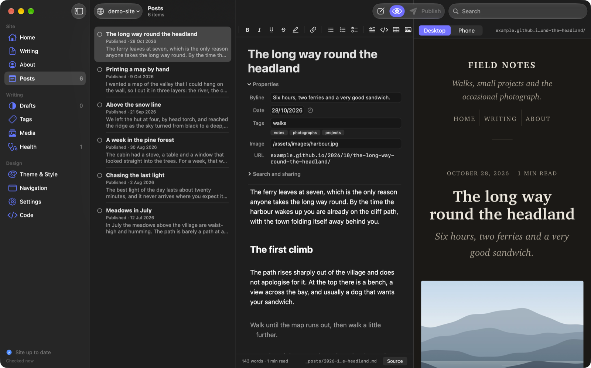
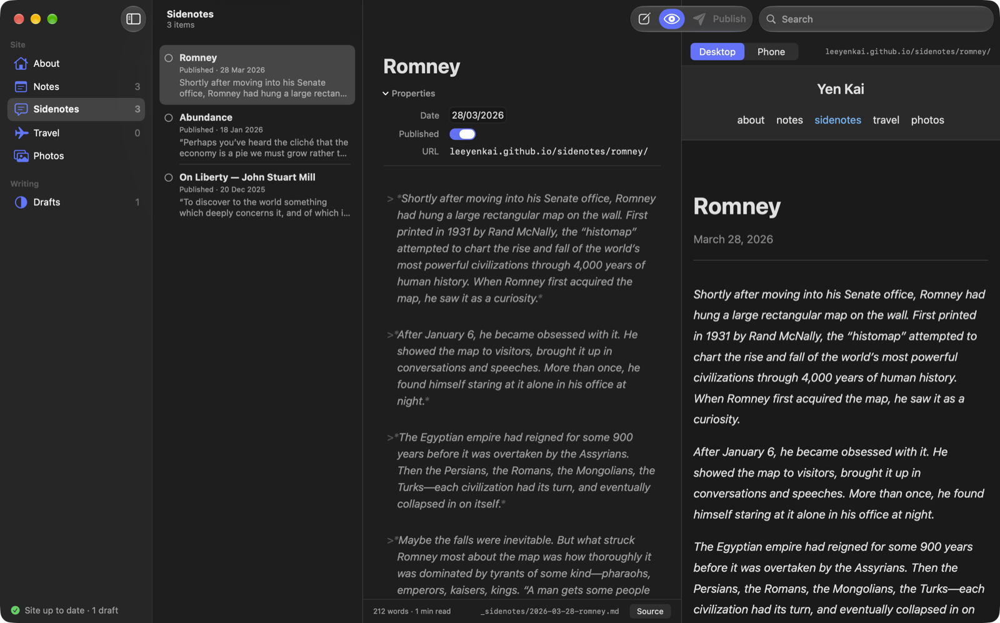

<p align="center">
  
</p>

<h1 align="center">Inkwell</h1>

<p align="center">Write, preview and publish posts on your GitHub Pages site, as easily as writing a note. A Mac app that keeps your site as plain files in your own repository.</p>



## Features

- **Sign in with GitHub and pick your site**, or create a new one from a theme. No git, Terminal or local folder needed: Inkwell keeps its own copy and publishes through GitHub.
- **Opens your existing site.** Sections, fields and URLs come from `_config.yml`, `_data/navigation.yml` and the posts already there. No config file.
- **Writes clean Markdown.** The editor styles Markdown as you type but saves exactly what you wrote, so untouched lines never change. Liquid tags show as chips you can't break by accident.
- **Properties instead of YAML.** Title, date, byline and the rest as fields, inferred per section, with warnings for unclosed quotes, bad dates and filename mismatches.
- **Images done for you.** Paste or drop a photo: it is resized, turned upright, cleaned of location data, named after the post and linked with `relative_url`. Drop several for a gallery.
- **Photos and media.** Keep a photo stream with a caption for each photo, and see every image in the site, where it is used, and which ones nothing uses.
- **A real preview.** Posts render through the site's own layouts, theme and styles (Sass included) as you type. Browse the whole site, at desktop or phone width, in light or dark mode.
- **Design without code, or with it.** Pick one of four themes, change colours, fonts and layout, edit the menu and site settings, set a custom domain, or open the code editor for layouts and styles. GitHub Pages themes such as minima work too.
- **Edit like a notes app.** Markdown markers fade away off the line you are on, lists continue on Return, `/` opens a menu of blocks, `[[` links to another post, pictures show in place, and tables open as a grid. Rename a post and its old address keeps working.
- **Private drafts, one-click publish.** Drafts stay on your Mac until you publish. Publishing checks the post, sends only its own files in one change, and tells you when GitHub Pages has it live. Update, unpublish or delete posts the same way, or date one in the future to schedule it; changes made on GitHub come in automatically.

| Draft with preview | Publish |
|---|---|
|  |  |
| **Sidenotes** | **Source** |
|  |  |

The screenshots show [leeyenkai.github.io](https://leeyenkai.github.io), the site Inkwell was built for.

## Build

```bash
./scripts/build.sh
```

Run `./scripts/fetch-engines.sh` once first (it fetches the pinned dart-sass the preview uses for Sass themes). Needs macOS 26 or later on Apple silicon and Xcode 27. To sign in, create a GitHub token with the `public_repo` and `workflow` scopes (the app links to the page). Tests: `cd InkwellKit && swift test`. Try it on a throwaway copy of a site with `./scripts/make-sample-site.sh <site folder>`.

Status: an early MVP. The plan and what is built are in [docs/SPEC.md](docs/SPEC.md), and the review behind them is in [docs/REVIEW.md](docs/REVIEW.md).
