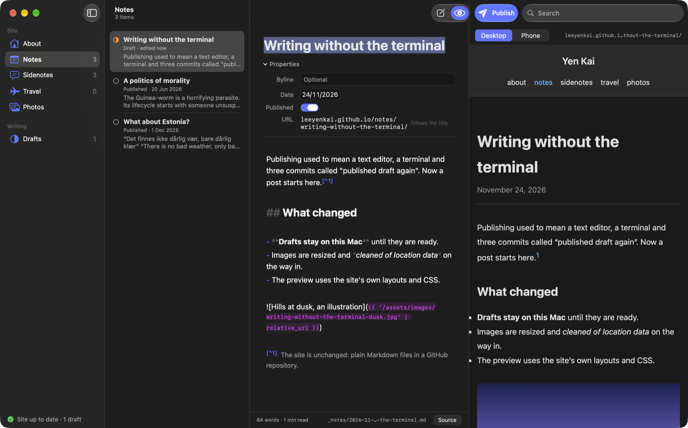

<p align="center">
  
</p>

<h1 align="center">Inkwell</h1>

<p align="center">Write, preview and publish posts on your GitHub Pages site, as easily as writing a note. A Mac app that keeps your site as plain files in your own repository.</p>


## Features

- **Opens your existing site.** Sections, fields and URLs come from `_config.yml`, `_data/navigation.yml` and the posts already there. No config file.
- **Writes clean Markdown.** The editor styles Markdown as you type but saves exactly what you wrote, so untouched lines never change. Liquid tags show as chips you can't break by accident.
- **Properties instead of YAML.** Title, date, byline and the rest as fields, inferred per section, with warnings for unclosed quotes, bad dates and filename mismatches.
- **Images done for you.** Paste or drop a photo: it is resized, turned upright, cleaned of location data, named after the post and linked with `relative_url`.
- **A real preview.** Posts render through the site's own layouts and CSS as you type, at desktop or phone width.
- **Private drafts, one-click publish.** Drafts stay on your Mac until you publish. Publishing checks the post, commits only its own files, pushes, and tells you when GitHub Pages has it live.

| Draft with preview | Publish |
|---|---|
|  |  |
| **Sidenotes** | **Source** |
|  |  |

The screenshots show [leeyenkai.github.io](https://leeyenkai.github.io), the site Inkwell was built for.

## Build

```bash
./scripts/build.sh
```

Needs macOS 26 or later on Apple silicon, Xcode 27 and git. Tests: `cd InkwellKit && swift test`. Try it on a throwaway copy of a site with `./scripts/make-sample-site.sh <site folder>`.

Status: an early MVP. The plan and what is built are in [docs/SPEC.md](docs/SPEC.md), and the review behind them is in [docs/REVIEW.md](docs/REVIEW.md).
