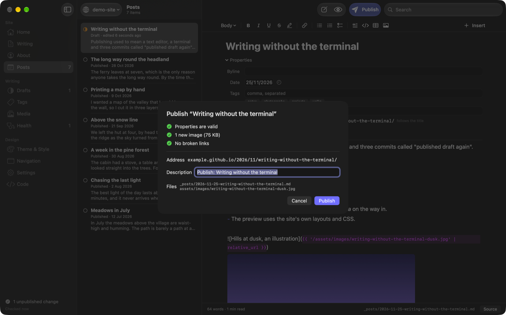
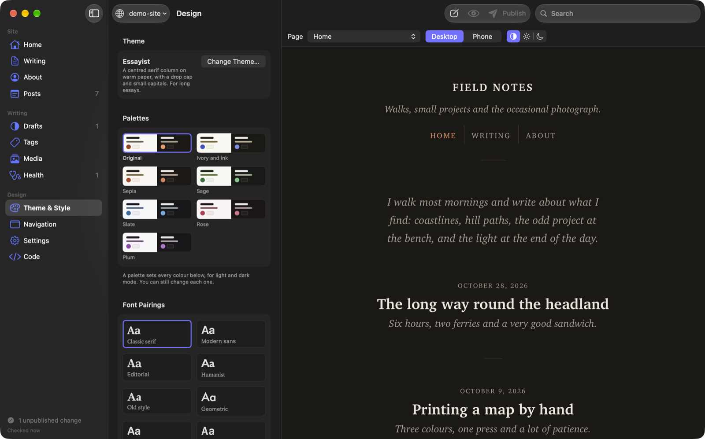
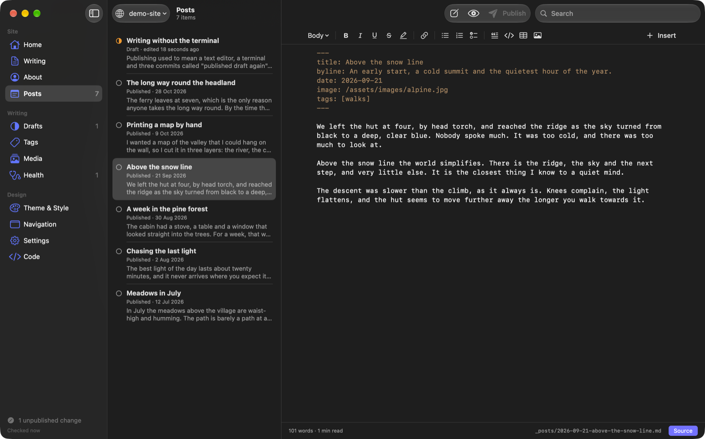
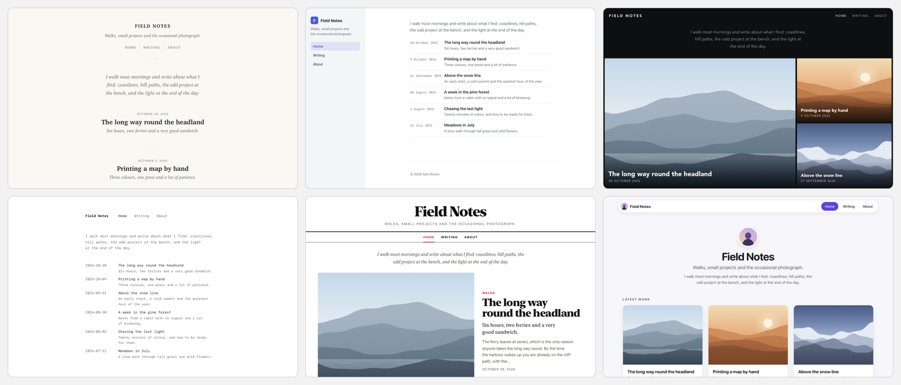

<p align="center">
  
</p>

<h1 align="center">Inkwell</h1>

<p align="center">Write, preview and publish posts on your GitHub Pages site, as easily as writing a note. A Mac app that keeps your site as plain files in your own repository.</p>


## Features

- **Sign in with GitHub and pick your site**, or create a new one from a theme. No git, Terminal or local folder needed: Inkwell keeps its own copy and publishes through GitHub.
- **Opens your existing site.** Sections, fields and URLs come from `_config.yml`, `_data/navigation.yml` and the posts already there. No config file.
- **Writes clean Markdown.** The editor styles Markdown as you type but saves exactly what you wrote, so untouched lines never change. Liquid tags show as chips you can't break by accident.
- **Properties instead of YAML.** Title, date, byline and the rest as fields, inferred per section, with warnings for unclosed quotes, bad dates and filename mismatches.
- **Images done for you.** Paste or drop a photo: it is resized, turned upright, cleaned of location data, named after the post and linked with `relative_url`. Drop several for a gallery.
- **Photos, albums and media.** Keep a photo stream with a caption for each photo, group photos into albums that get their own pages, and see every image in the site, where it is used, and which ones nothing uses.
- **A real preview.** Posts render through the site's own layouts, theme and styles (Sass included) as you type. Browse the whole site, at desktop or phone width, in light or dark mode.
- **Design your site.** Six themes that differ in layout, not just colour (an essay column, a notebook with a sidebar, a photo grid, plain monospaced text, a magazine front page, a portfolio), each shown as it really looks and tried on your own posts before you switch. Then palettes, font pairings, colours, fonts and layout, the menu, site settings and a custom domain, or the code editor for layouts and styles. GitHub Pages themes such as minima work too.
- **Pages with elements.** New pages start from templates (About, Now, Contact, Projects, Links, Timeline, Places, a landing page, an archive, albums, slides). Add galleries, slideshows, maps, timelines, callouts, columns, toggles, tabs, buttons, cards, banners, recent posts and more to any page; each stays plain text that GitHub Pages builds on its own, with a form for its settings.
- **Edit like a notes app.** A formatting bar, ⌘K to link any words to another post, a heading or the web (search included), ⌘-click to follow a link, checklists you tick with a click, find and replace. Markdown markers fade away off the line you are on, lists continue on Return, `/` opens a menu of blocks and elements, pictures show in place, and tables open as a grid. Rename a post and its old address keeps working.
- **Keeps the site healthy.** Health finds broken links and images, missing alt text, oversized pictures and missing search and sharing basics, and fixes the safe ones in one click. Each post gets a description, share image and link preview.
- **Websites, not only blogs.** Product pages, project docs and hand-written HTML sites open too, including a site in a repository's `docs/` folder. Edit a page's HTML beside a live preview, or click text, pictures and links on the preview to change them in place; only those characters change in the file. Change the menu once for every page that shares it. Sites built by another tool open read only, and nothing Jekyll-specific is ever written into a site GitHub serves as it is.
- **Private drafts, one-click publish.** Drafts stay on your Mac until you publish. Publishing checks the post, sends only its own files in one change, and tells you when GitHub Pages has it live. Update, unpublish or delete posts the same way, or date one in the future to schedule it; changes made on GitHub come in automatically.

| Draft with preview | Publish |
|---|---|
|  |  |
| **Theme & Style** | **Source** |
|  |  |



The screenshots show Field Notes, a made-up site with invented posts and photographs (`./scripts/make-demo-site.sh` makes a copy to try Inkwell on).

## Download

Inkwell needs macOS 26 or later on a Mac with Apple silicon.

1. Download `Inkwell-<version>.dmg` from Releases and drag Inkwell into Applications.
2. This beta is not notarized by Apple yet, so the first time you open it macOS says it cannot check the app. Click Done, open **System Settings › Privacy & Security**, click **Open Anyway** next to Inkwell, and confirm. You do this once per version.
3. Sign in with GitHub and pick your site. Inkwell keeps its own copy, so you need no git, Terminal or local folder.

Inkwell checks once a day for a newer version (you can turn this off in Settings) and offers it as a download. Drafts, sites and the sign-in carry over. Each update may ask for your Mac password once to let the new version read the sign-in from your keychain.

**Privacy:** no analytics and no server of its own. Inkwell only talks to GitHub, and to the sites your posts link to when you click Check Links. See [docs/PRIVACY.md](docs/PRIVACY.md).

## Build

```bash
./scripts/build.sh
```

Run `./scripts/fetch-engines.sh` once first (it fetches the pinned dart-sass the preview uses for Sass themes). Needs macOS 26 or later on Apple silicon and Xcode 27. To sign in, create a GitHub token with the `repo` and `workflow` scopes; GitHub needs `repo` to read and change Pages settings, and the app links to the page.

- Tests: `cd InkwellKit && swift test`.
- Try it without touching a real site: `./scripts/make-demo-site.sh` makes the made-up blog, `./scripts/make-plain-site.sh` a hand-built HTML site, and `./scripts/make-sample-site.sh <site folder>` a throwaway copy of your own. Each gets a local stand-in for GitHub, so publishing goes nowhere. Open one with `open -n <Inkwell.app> --args --site <folder>`.

Status: beta (0.11.0). Release disk images come from `./scripts/make-dmg.sh`. The plan and what is built are in [docs/SPEC.md](docs/SPEC.md), and the review behind them is in [docs/REVIEW.md](docs/REVIEW.md).
